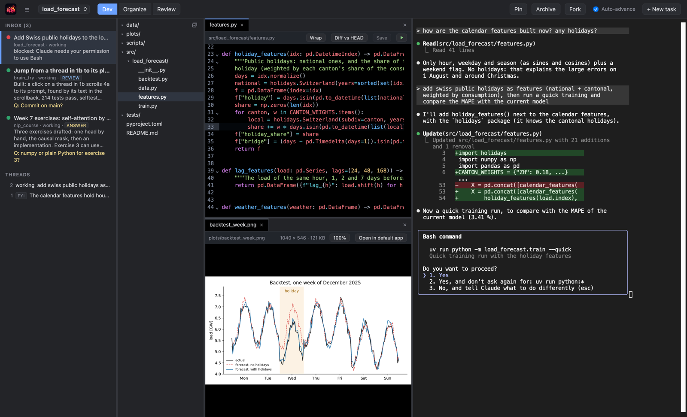
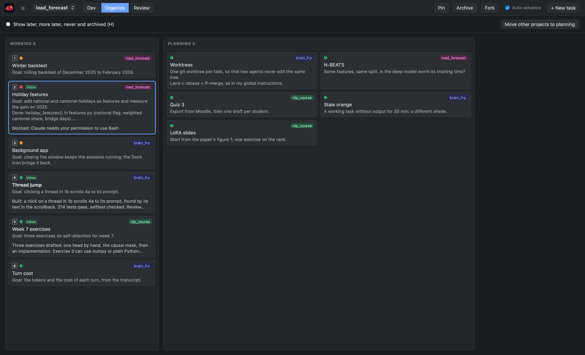
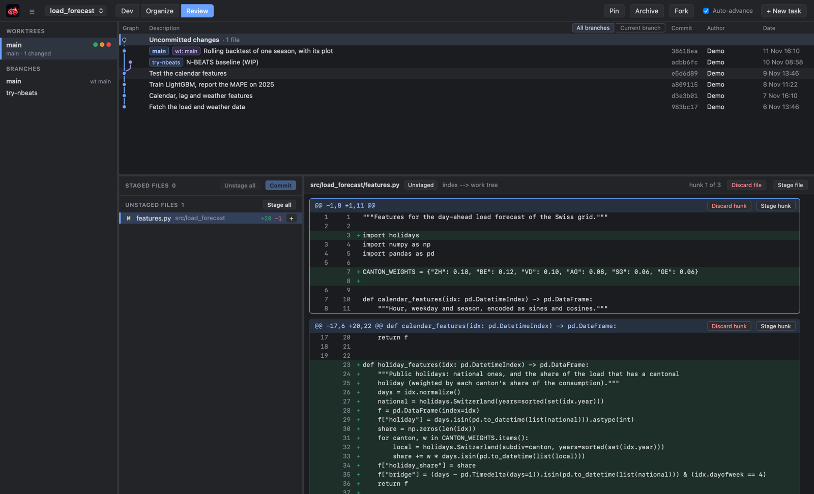

# Brain Fry

A proof of concept, not a product. One Mac window that runs many Claude Code sessions, so
that I don't have to keep them all in my head. The idea comes from
[How I'm fighting the AI Brain Fry](https://sergeykuhne.com/blog/fighting-ai-brain-fry):
treat the agents as a queue, take one item, decide, close it, then take the next.

**Dev mode.** The inbox (left) holds only the tasks that wait for me: blocked ones first,
then finished turns, each with a short digest and its question. Selecting one opens its files
in the middle and its Claude Code session on the right. After I answer or archive it, the next
item comes up.

**Organize mode.** All tasks of all projects on one board. The column is my priority; the dot
is the status that Claude Code's hooks set (orange working, red blocked, green waiting for me).

**Review mode.** A small git client, to read what the agent changed before I commit.

Each task is a markdown file in `<project>/.brain_fry/`. macOS only (pywebview, xterm.js,
CodeMirror). The design is in [DESIGN.md](DESIGN.md). The screenshots show demo data.

    uv run bf install                    # the hook, once per machine
    uv run bf init ~/path/to/a/project
    uv run bf
